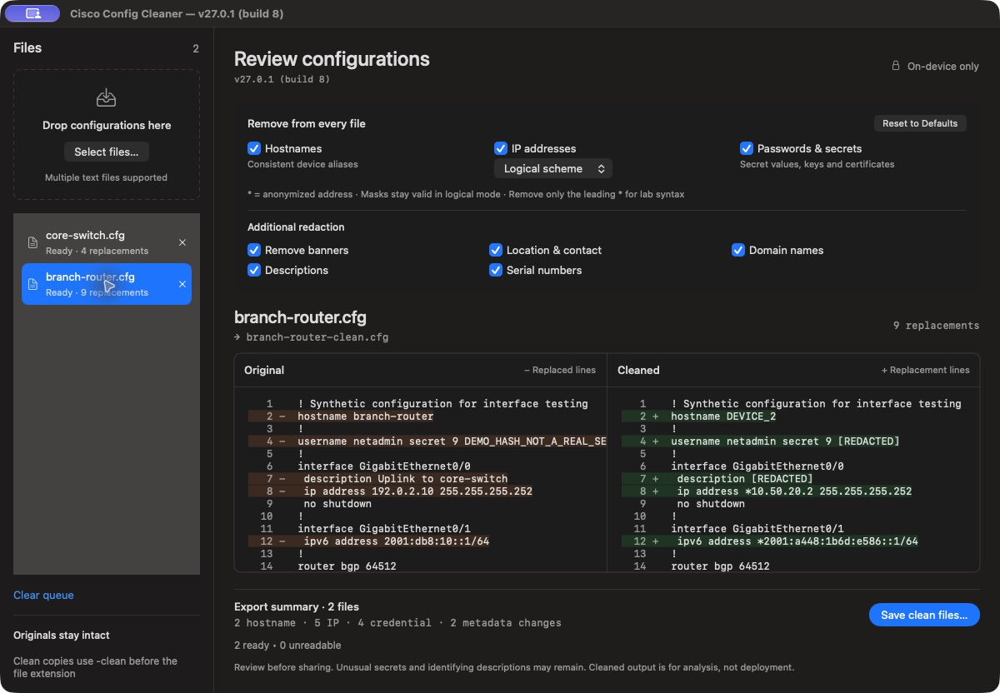
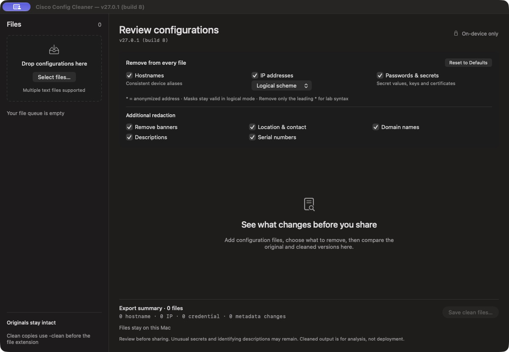

# Config Cleaner

Native macOS utility for reviewing and anonymizing batches of Cisco configuration files. Processing stays on your Mac.

Free for personal and internal business use under the [Limited Use License](LICENSE). External redistribution requires permission, subject to the terms of that license.

Previously named Cisco Config Cleaner.

## Screenshots

The screenshots use the synthetic configurations in `fixtures/`; no production configuration is shown.





See [the ranked repository audit and fixes](AUDIT.md) for the November 23, 2026 review. Screenshots show source version 27.0.1; the release download may be an earlier build.

## Download and install

Download the app ZIP from the [latest GitHub release](https://github.com/waynelyon/cisco-config-cleaner/releases/latest), unzip it, and drag **Config Cleaner.app** into **Applications**.

Starting with version 27.0.3, the application is named **Config Cleaner.app**. Older releases use the previous name. The bundle identifier is unchanged to preserve existing preferences. Quit the older application before installing the new one; the new filename does not automatically replace the old application.

The release is universal (Apple Silicon and Intel) and targets macOS 14 or later. It is locally ad-hoc signed, not Apple Developer ID signed or notarized. macOS may block the downloaded app; after attempting to open it, use **System Settings → Privacy & Security → Open Anyway** if you trust this release. Do not disable Gatekeeper globally. A SHA-256 checksum is included with the release.

Maintainers can build a universal release ZIP with `zsh release.sh`. Release builds run regression checks on the host architecture. Cross-compilation does not replace testing on Intel hardware or older macOS versions.

## Build from source

Requires macOS with Xcode or the Xcode command-line tools installed and a Swift toolchain that supports the SwiftUI APIs used here.

```sh
git clone https://github.com/waynelyon/cisco-config-cleaner.git
cd cisco-config-cleaner
zsh build.sh
open "Config Cleaner.app"
```

The build runs the regression checks, packages the icon and metadata, and signs the app locally. It does not notarize it for distribution. Copy the resulting app into Applications if desired. No third-party package installation is required.

Open `Config Cleaner.app`. Drop text configuration files into the window or choose **Select Files…**. Select hostname, IP address, and credential removal independently, review the preview, then choose **Save Clean Files…** and an output folder.

`router.cfg` becomes `router-clean.cfg`. Existing files are never overwritten; conflicts become `router-2-clean.cfg`. Originals are unchanged. Processing happens locally, without network calls, logging, or saved replacement maps.

Hostnames declared with `hostname` or `switchname` receive consistent aliases across the batch. Known value positions in `logging host`, `ntp server/peer`, `snmp-server host`, and `neighbor` references are also replaced. Other references require manual review; command keywords are never globally substituted. IP cleaning defaults to a logical address scheme; labels remain available from the Mode picker. Turn IP cleaning off to retain original addressing. Logical mode preserves recognized subnet and wildcard masks and prefixes, while adding `*` before changed addresses. Credential values are replaced with `[REDACTED]`, preserving command prefixes, encryption type markers, and supported trailing options. Common password, secret, SNMP, TACACS/RADIUS key, pre-shared key, certificate, and PEM private key formats are covered.

Review before sharing: this is a rules-based sanitizer, not a guarantee of complete anonymization. Unusual Cisco syntax, usernames, domain names, descriptions, serial numbers, MAC addresses, or embedded scripts can retain sensitive content. Text files up to 20 MB each are supported, with at most 500 queued files and 100 MB of decoded input per batch. The app is locally compiled, not notarized for distribution.

### Important usage limitations

Review the complete exported files before sharing them with third parties or AI services. Preview content, replacement counts, and residual-secret warnings do not certify that an export is safe. Anonymized configurations are for review and analysis, not for deployment to production network devices.

The application is provided without warranty. Users are responsible for compliance with their organization's security, confidentiality, and data-handling policies.

Source: `main.swift` and `AddressScheme.swift`. Build with `zsh build.sh`. Run the bundled executable with `--self-test` for basic sanitizer checks.

## Updated native interface

The SwiftUI/AppKit interface includes a file sidebar with individual removal, a highlighted drop target, grouped cleaning options, and a per-file original/cleaned comparison. Replaced lines use −/+ markers and semantic highlights. The footer shows batch replacement counts; each file shows its planned output name. Counts describe substitution operations, not unique identities or a completeness guarantee. Multiline credential blocks count as a single redaction; their headers and terminators remain while the payload is redacted.

Use Command-O to select files and Command-S to save. Preview text is selectable and supports copying. Preview is limited to the first 2,000 lines / 200,000 characters per side; exports contain the full cleaned text. Filename conflicts are resolved without overwriting. Duplicate names within a batch receive numbered names.

UI design process: [Unslop](https://github.com/heydamir/unslop) by Damir Sokolovsky, [CC BY 4.0](https://creativecommons.org/licenses/by/4.0/). See [DESIGN.md](DESIGN.md) for the native adaptations and [Third-Party Notices](THIRD-PARTY-NOTICES.md) for attribution.

Verification: sanitizer regression checks, replacement counts, multiline diff alignment detection, unchanged-line detection, duplicate naming, option updates, and queue selection after removal. Native UI checked with the synthetic configurations in fixtures/.

Examples: `username admin secret 9 HASH` becomes `username admin secret 9 [REDACTED]`; `snmp-server community PRIVATE RO ACL` becomes `snmp-server community [REDACTED] RO ACL`. Credential-preservation checks cover quoted values, CRLF, SNMP auth/privacy, key-chain identifiers, and repeated cleaning.


## Logical IP mapping and review markers

Example: `ip address *10.50.20.1 255.255.255.0`. The leading `*` marks an anonymized address and makes that address token invalid. Remove only the marker immediately before an address to recover valid IP syntax for a reviewed lab configuration. Avoid a blanket replacement of every asterisk, since other configuration syntax may contain legitimate asterisks. Passwords remain `[REDACTED]` and must be supplied separately.

Every export includes a legend and review-only header. Markers are an accidental-use deterrent, not a deployment interlock: unmarked configuration lines can still execute if pasted. No text export can prevent intentional edits or guarantee safety on a device.

Logical mode applies a reversible randomized batch-wide XOR permutation to IPv4 and IPv6 addresses. It preserves repeated-address relationships, subnet membership, and host bits under recognized masks/prefixes. Common route masks, ACL wildcard masks (including noncontiguous ACL masks), CIDR prefixes, and interface masks are recognized. Without explicit prefixes it preserves /24 IPv4 and /64 IPv6 host portions. IPv6 class bits stay unchanged. Special default, loopback, link-local, multicast and broadcast addresses stay unchanged. This is structural pseudonymization, not cryptographic privacy: it reveals relationships and a known original/mapped pair can reveal the permutation. It does not hide network size or topology.

Mappings can use publicly routable synthetic addresses; this is not a private-address allocator. Use only in an isolated lab after checking all dependencies. A broad or incompatible prefix constraint can force label replacements, explicitly reported in the interface. Unknown vendor syntax is not guaranteed to be parsed correctly. Subnet masks and special addresses are intentionally retained. Adding/removing files can change the batch mapping; export related devices together.

Checks cover IPv4 prefix sizes /8–/32, subnet membership and host-bit preservation, broad routes, repeated peers, CIDR notation, ACL masks, IPv6 spelling normalization, special addresses, marker removal, and export legends. Tests are in `SchemeTests.swift` and the main self-test entry point.

## Identity metadata and SNMP handling

When enabled, metadata cleaning removes delimiter-based banner blocks, SNMP location/contact/chassis-id lines, and standalone location metadata. It redacts values in `ip domain name`, `ip domain-name`, domain lists, `domain-name`, descriptions, and SNMP name/sysname commands. This metadata cleanup is independent of the credential checkbox; metadata changes are included in the totals (removed lines and redacted values). Unknown identifying fields and free-form comments still require review.

`password encryption aes` is an encryption setting and remains unchanged. SNMP host community strings are redacted both with explicit version 1/2c and with implicit v1 (no version clause), retaining the host command and trailing options. Version 3 usernames are not treated as community strings.

## Version 1.1.0 (build 2)

The running executable's version is shown in the window title and beneath “Review configurations.” Version/build labels are compiled into the binary so an older running copy cannot adopt the version of a replacement bundle on disk. RADIUS `server-private … key` values are now redacted, including type 0/6/7, optional ports/timeouts, quoted values, IPv6 servers, and combined AAA lines. Tests cover command preservation and repeat cleaning.

## Version 1.2.0 (build 3)

Banners, location/contact metadata, domain names, descriptions, and serial numbers now have separate checkboxes (all enabled by default). This supersedes the earlier mandatory identity-cleanup behavior. Secret parsing covers additional documented command variants while preserving syntax fields. See SECRET-COVERAGE.md for findings, Cisco references, tested formats and limits. Serial number detection targets explicit serial/UDI fields; unlabeled identifiers still need manual review.

## Version 1.2.1 (build 4)

All nine option values are saved automatically using macOS UserDefaults: hostnames, addresses, logical/label mapping, secrets, banners, location/contact, domains, descriptions, and serial numbers. Previously disabled options remain disabled at the next launch. New installations use the existing enabled defaults. Only preferences are saved; file queues, configuration content and replacement maps are not persisted. Tests use a separate temporary preferences domain and verify both disabled values and nested identity-option changes.

## Version 1.2.2 (build 5)

The file picker remembers the parent folder of the last confirmed file selection. The export picker separately remembers the last folder where a clean file was successfully saved. Both paths persist in macOS preferences across launches. Cancelling either picker does not change its remembered folder. Missing or unreadable folders fall back to the normal system picker location. Only folder paths and option values are stored, not configuration contents.

## Version 1.2.3 (build 6)

Reset to Defaults appears at the top of the cleaning-options panel. It enables all cleaning checkboxes, selects logical IP mapping, persists those defaults, and refreshes the current previews. It preserves the file queue, selected file, and remembered input/output folders.

## Version 27.0.0 (build 7)

Fixes credential leakage caused by hostname/command keyword collisions, including cross-file batches. Hostname replacement now targets known value positions rather than rewriting arbitrary words. Numeric standalone keys are redacted unless they are indented entries in a recognized key-chain block; include the block header when cleaning fragments to preserve key IDs. Metadata redactions and removed lines now contribute to per-file totals and have their own batch counter.

Regression coverage includes keyword hostnames, alias collisions, VRF references, numeric RADIUS/TACACS keys, retained key-chain IDs, CRLF input, banners containing credential-like text, and metadata-only totals. Unknown hostname references and unusual Cisco syntax still need review.

## Version 27.0.1 privacy hardening

Use the AI-safe preset to enable the existing redaction options, label-mode IP handling, anonymous filenames, and separate explicit username, MAC and circuit-ID removal. Changes are visible in the preview. In v27.0.2 extra substitutions contribute to the metadata count. Export warns about disabled options and possible remaining secret keywords; the scan is heuristic and cannot certify that a file is safe. Review complete outputs, including beyond preview limits. Logical mode uses a fresh system-random mapping on each recomputation and remains reversible pseudonymization. See [privacy review](PRIVACY-REVIEW.md) and [security policy](SECURITY.md). Read [Before you paste that show-tech into AI](https://www.waynelyon.com/notes/before-you-paste-show-tech.html) for context. No guarantee of sanitizing arbitrary diagnostic dumps.

## Version 27.0.2 (build 9)

Independent RFC1918 IPv4, other IPv4 (including public and non-RFC1918 special-use unicast), and IPv6 controls; protocol-special addresses and recognized masks remain unchanged. Selective replacement uses labels, even if logical mode is selected, to avoid collisions with retained addresses. All privacy choices persist. Known SNMPv3, PPP and explicit diagnostic username fields are now covered. Extra substitutions count as metadata changes. Residual-secret detection examines individual fields and lists cleaned line numbers per file before export; counts are heuristic and not a safety guarantee. Review complete files before sharing. The screenshots show an earlier UI. The latest downloadable release may lag source; verify the release version before using it.

## Version 27.0.3 (build 10)

Renamed the application to Config Cleaner. Added the Limited Use License, third-party notices, application menu access to the licensing documents, and CI verification of the documents in the signed app and release ZIP. The bundle identifier and sanitizer behavior remain unchanged.

## Optional signed and notarized distribution

The default CI and local release builds are ad-hoc signed. A maintainer with an installed Apple Developer ID Application certificate and an existing notarytool Keychain profile can run:

```sh
SIGNING_IDENTITY="Developer ID Application: YOUR NAME (TEAMID)" NOTARY_PROFILE="cisco-cleaner-notary" zsh release.sh
```

The script uses hardened runtime, submits a temporary archive, staples and validates the ticket, checks Gatekeeper, and creates a fresh final archive and SHA-256 checksum. Do not commit credentials or export private keys to this repository. CI retains the tested ad-hoc universal archive and checksum as an Actions artifact for 14 days. Artifact upload alone is not a published GitHub release. The explicitly authorized 27.0.3 release is gated on successful build, regression, signing, checksum and license checks.

## Licensing

Copyright © 2026 Wayne Lyon. All rights reserved.

Original project material is licensed under the [Limited Use License](LICENSE). Personal and internal business use, including professional services to customers, is free. Internal copying and modification are permitted under the license.

External redistribution, resale, and commercial packaging require prior written permission, except where otherwise permitted by applicable law or existing rights. The license preserves GitHub's applicable viewing and forking permissions. This project is source-available, not open source.

The project license does not claim ownership of user-provided configurations or cleaned output and does not impose its terms on that content. Third-party material remains subject to its respective terms. See [Third-Party Notices](THIRD-PARTY-NOTICES.md).

Builds that include the licensing documents provide **License…** and **Third-Party Notices…** in the application menu. The documents are also in the application bundle's `Contents/Resources` directory. Earlier releases may not contain these documents.

This is an independent utility and is not affiliated with, sponsored by, or endorsed by Cisco Systems, Inc. Cisco and IOS XE are trademarks of their respective owners.
